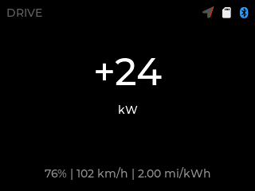
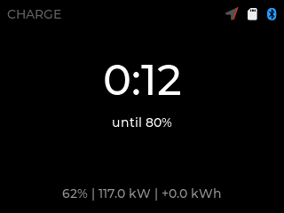
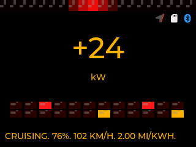
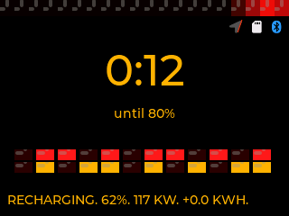

# RangeReality

Your Lightning knows exactly what it's doing. Now you will too.

RangeReality is a live telemetry display for the F-150 Lightning.
It turns a low-cost dash display into the instrument cluster Ford
didn't give you: real power flow, real charging truth, and real
trip numbers - no subscription, no cloud, no account.

## Driving: see every kilowatt

- **Live power and regen**, responding the instant your foot moves
- **Your efficiency vs. your pace** - know immediately whether this
  trip is beating your average or burning through it
- **Plain-language coaching** when conditions change, quiet when
  they don't

## Charging: stop guessing, start planning

- **Live charge rate** with recent history, so you can see a taper
  or a throttled stall as it happens
- **Time until 80% and 100%**, computed from your actual session -
  not a brochure number
- **Automatic AC/DC handling**: plug into a home charger or a
  170 kW fast charger and the display adapts

## Trips: your data, on your card

Every drive and charge session logs to the microSD card: distance,
energy, efficiency, peaks, and timestamps. Pull the card, open the
spreadsheet, settle the debate.

## Private by design

Everything runs locally between the display and your truck. There
is no server, no tracking, and nothing to sign into. Setup happens
over a QR code and a local web page; your truck never touches our
computers, because there is nothing of yours to send.

## What you need

- A Cheap Yellow Display (ESP32-2432S028, the ~$15 touchscreen
  this was designed around)
- A standard Bluetooth OBD adapter for the truck's diagnostic port
- Five minutes: flash from your browser, plug in, drive

## Shots

The Minimalist theme, simulated at native resolution:

The KITT theme:

More captures live in [shots/](shots/).

## Status

In development and bench-validated on real hardware. See
[roadmap](roadmap.md) for what's landed and what's next, and
[shots/](shots/) for the display in action.

Firmware will be a one-click browser flash at the first public
release - no cables, no toolchain.
